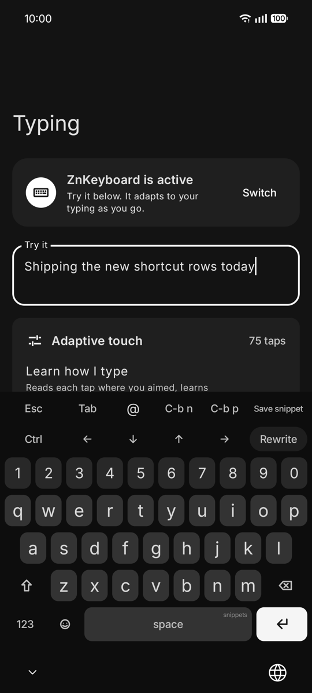
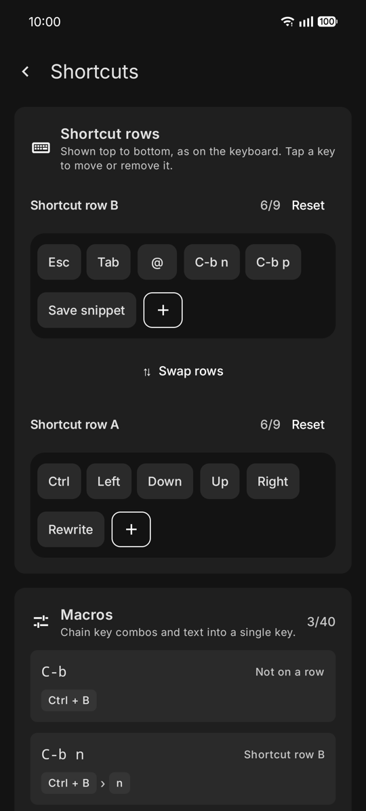
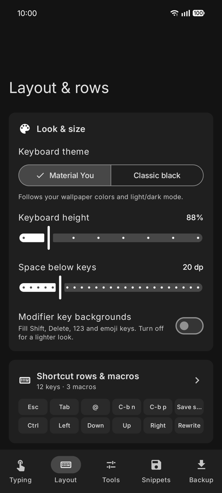
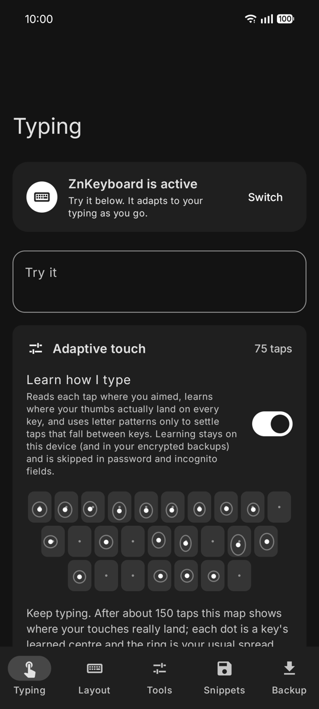

# ZnKeyboard

A modern, privacy-respecting custom keyboard (input method editor) for Android, built with Kotlin and Jetpack Compose. ZnKeyboard pairs a fast custom typing surface with **Chinese pinyin input** and a built‑in **AI assistant** that polishes your text — or polishes and translates it for customers abroad — using your own API key — Google Gemini built in, or any OpenAI‑compatible endpoint.

> This is a modified fork of [zainbits/zn-keyboard](https://github.com/zainbits/zn-keyboard). It adds pinyin input and AI polish and translate (润色 / AI翻译), and removes the GIF, emoji, text-snippet and macro features to keep the keyboard small (release APK ≈ 4.6 MB). Screenshots below are from upstream and predate these changes.


<p align="center">
  
  
  
  
</p>

---

## Why ZnKeyboard

Most "AI keyboards" send your keystrokes to a vendor's cloud. ZnKeyboard takes the opposite stance:

- **Bring your own key.** AI features call your own OpenAI / OpenAI‑compatible endpoint. There is no ZnKeyboard backend in the middle.
- **Keys never leave the device in plaintext.** API keys are encrypted at rest with the Android Keystore (AES/GCM). A user-created backup can include them only inside a password-encrypted file.
- **AI is opt‑in.** The keyboard is fully usable with the agent disabled; nothing is sent anywhere unless you turn it on and trigger it.

## Features

### 🎯 Adaptive touch: fewer missed keys
ZnKeyboard learns how *your* thumbs actually hit each key and decodes every tap with that, instead of plain rectangles. The full research and numbers are in [docs/typing-accuracy.md](docs/typing-accuracy.md).
- **Key decided at touch-down** with roll hysteresis, so finger drift on lift no longer types the neighbouring key.
- **A personal touch model for each key** (per orientation), with hierarchical shrinkage so rare keys learn from their neighbours.
- **Learns from your corrections:** backspacing a letter and typing its neighbour teaches the model where that tap really belonged. There is no calibration step.
- **Anchored letter prior:** context only settles taps that fall *between* keys. A tap on the centre of a key always types that key. The prior adapts to how you write, Hinglish included.
- **Haptics and a key popup** so you can feel and see each keystroke. Shift tap/double-tap caps lock, auto-capitalisation, and double-space period.
- **See what it learned:** Settings → Typing has a "Try it" field and a per-key touch map showing each key's learned centre and spread.
- In simulation, letter errors drop from about 8% to about 1.3%. Learning stays on the device, is never backed up, and is skipped in password and incognito fields.

### 🀄 Chinese pinyin input
- A **中/EN key** (left of the comma) switches between pinyin and English. A candidate bar above the keys shows the typed pinyin and the candidates; space picks the first, a tap or `1`–`9` picks another.
- **Full pinyin, 简拼 initials and phrases:** `nihao` → 你好, `nh` → 你好/女孩/…, `zgr` → 中国人, `nihaoma` → 你好吗. Syllables split automatically; `'` separates them by hand (`xi'an`).
- **Seven fuzzy-sound toggles** (Settings → Typing → Chinese pinyin): z=zh, c=ch, s=sh, n=l, an=ang, en=eng, in=ing. Single-letter initials stay strict, so `n` never pulls in `l` words.
- Comma and period keys beside space type `，` `。` in pinyin mode and `,` `.` in English; `,.?!:;()` become full-width while typing Chinese, except a period right after a digit.
- **Learns your words:** words you pick move up, and a phrase you build from several picks in one go (at least one tapped or chosen by number) is remembered for its full pinyin and 简拼, e.g. 王 + 小 + 风 → `wxf` gives 王小风. Space-only conversions are never joined into phrases.
- **Next-word suggestions:** after a commit the bar suggests what comes next: words you typed after it before, then longer dictionary words it starts (中国 → 人, 人民, 共产党…). Picking one keeps the chain going; any other key dismisses them.
- Learning stays on the device (and inside the password-encrypted backup), is skipped in password and incognito fields, and can be turned off or cleared in Settings → Typing → Chinese pinyin, as can suggestions.
- Dictionary: 8,757 characters and the 150,000 most frequent words from [rime-ice](https://github.com/iDvel/rime-ice) (GPL‑3.0), with a few joke weights corrected.

### 🌐 润色 / AI翻译: polish and translate
- In both modes the row starts **润色 | AI翻译 | (EN)** — labelled **Polish | Translate** in EN mode. **润色** only polishes what you typed; **AI翻译** polishes it and translates it into the language on the ink‑blue badge inside that button — **EN, ES, JA, FR or DE** (text already in that language is just polished). Tap the badge, or long‑press the button, to switch language. Settings → Tools → *Translate to* sets the same choice.
- In 中 mode the review panel and its errors are in Chinese (取消 / 应用 / 复制).

### 🎙️ Hold-space voice input
- Hold the space bar (labelled **按住说话** / **hold to talk**) and speak; release to insert. 中 mode writes down what you said without filler words; EN mode also translates it into the *Translate to* language. Slide up into the panel above the keys to cancel.
- Uses Google Gemini with the key saved under that provider. Audio is kept only in memory and never saved; off in password fields. Turn it on in Settings → Tools → Voice input.

### ✍️ AI rewrite assistant ("agent mode")
- Rewrite, polish, or restructure the text in the current field with one tap, then review the result before it replaces anything.
- **Two providers:** **Google Gemini** with a built‑in endpoint and a model picker (recommended `gemini-3.5-flash-lite`; the rest of the list is loaded live with your key, text models only), or **OpenAI compatible** with your own base URL and model (OpenAI, OpenRouter, a local server, …). Each provider keeps its own key and model. Reasoning stays off for Gemini and is adjustable for custom endpoints.
- **App‑aware prompts:** rewrites adapt to where you are typing — e.g. a dedicated WhatsApp profile that preserves casual Romanized Hindi/Urdu code‑switching instead of flattening it.
- **Structured, safe output:** the model is constrained to a JSON `{ "text": ... }` contract, with optional reasoning modes for compatible models.
- Encrypted key storage via the Android Keystore.

### 🧩 Customizable extra button rows
Turn the keyboard into *your* keyboard. Add and arrange extra shortcut rows from a deep menu of keys most keyboards never give you:
- **Cursor & navigation:** arrow keys, `Home`/`End`, `PgUp`/`PgDn`, `Del`.
- **Modifiers & control:** `Ctrl`, `Alt`, `Tab`, `Esc` (latched only for the dispatched action).
- **Every symbol:** all ASCII punctuation plus `€`, `£`, `¥`, `•`.
- **Defaults:** only the Rewrite row is shown, with 📋 `@ & % ?`; the Esc/Tab/Ctrl/Alt/arrow row is opt‑in.
- **Dedicated Shortcuts screen** with a live preview of both rows, a categorized key palette (tap to add, tap again to remove), swappable row order, and a confirmation before a row is reset to defaults.
- Shortcut rows never change the height of the letter keys, so your muscle memory stays put.

### 📋 Clipboard history
- **Long-press space** to open recent copies for quick re‑pasting — no more re‑copying the same address, code, or link. Search them from the same panel.
- On‑device only. Clear it from Settings → Backup.

### ⌨️ A real keyboard, done right
- Custom high‑performance typing `View` (not a WebView, not Compose on the hot path) with press feedback tuned to feel like a stock key.
- The symbols key reads **!?#** (digits already sit in the number row above the letters).
- Gboard‑style **spacebar cursor dragging** for precise caret movement, with a haptic tick per character.
- **Material You theme** that follows your wallpaper and light/dark mode, or a true-black **Classic black** theme. Adjustable key height (extra rows add to the keyboard instead of shrinking keys), space below the keys, and optional filled modifier keys.
- Selection‑aware deletion and correct editor‑action handling (`Done`, `Go`, `Next`, `Search`, `Send`, etc.).
- **Password-encrypted backup & restore** for settings, clipboard history, learned typing, and configured API credentials.

### 💧 Liquid navigation in the settings app

<p align="center">
  
</p>

The settings app is edge-to-edge: content scrolls behind a floating title pill and a floating nav bar. The selected tab is its own accent pill. Switching tabs makes it **pinch off like a drop of liquid**, and the old tab flows back into its group.
- **No built-in API could do this.** Android's shape morphing only turns one outline into another, and a drop goes from one shape to two. So ZnKeyboard has a small engine of its own.
- **Based on how real liquid behaves:** the neck between pills is drawn as circular arcs, which is the shape liquid takes in 2D. The neck thins faster just before it snaps, and a new bridge grows fast at first when two pills merge.
- **Pure-Kotlin physics core** (`liquidnav/LiquidNavModel`): exact damped springs on a fixed 500 Hz step, so the motion is the same on 60, 90 and 120 Hz screens. Tapping another tab mid-animation continues smoothly from wherever it is.
- **AGSL shader renderer:** crisp 1px anti-aliased edges and a thin outline that wraps the neck as it stretches. Icons and labels sit in a separate layer, so they stay sharp. No per-frame allocation.
- The bar's outer bottom corners follow your phone's rounded screen corners. It respects the system animation scale, TalkBack tab semantics, RTL, and light/dark themes.
- Tune the motion in [previews/liquid-nav-drop.html](previews/liquid-nav-drop.html), which runs the same engine and shader in a browser.

## Architecture

Single‑module Android app (`:app`), package `dev.zain.znkeyboard`.

| Layer | What it does |
| --- | --- |
| `ime/ZnKeyboardInputMethodService` | The `InputMethodService` entry point; owns the input lifecycle and `InputConnection`. |
| `ime/ZnKeyboardView` | The custom keyboard surface — drawing, touch handling, gestures. |
| `ime/AgentReviewView` + prompt assets | AI rewrite UI and the OpenAI request/response flow. |
| `ime/PinyinCandidateBar` | Candidate strip above the keys; also lists target languages for AI翻译. |
| `pinyin/` | Pinyin engine in pure Kotlin: `PinyinFuzzy` (fuzzy-sound folding), `PinyinDictionary` (exact and 简拼 indexes), `PinyinEngine` (segmentation and ranking). |
| `ime/ClipboardPanelView`, `ime/ClipboardSearchView` | Clipboard history panel and its search. |
| `SettingsActivity` (Jetpack Compose, Material 3) | Edge-to-edge settings app with a floating title pill and four tabs: Typing, Layout, Tools (AI), and Backup (with clipboard history). |
| `liquidnav/` | Liquid nav bar: `LiquidNavModel` (pure-Kotlin springs and neck physics) and `LiquidNavBar` (Compose layout and AGSL shader). |
| `ShortcutsScreen` | Shortcut row editor and key palette. |
| `typing/` | Adaptive touch decoding (`TouchModel`, `CharLanguageModel`, `TouchDecoder`, `TypingLearner`) in pure Kotlin, wired up by `AdaptiveTypingEngine`. |
| `KeyboardSettings` | Single source of truth for persisted settings and encrypted secrets. |
| `constants/` | Centralized dimensions, colors, and defaults. |

Hot paths (`onDraw`, `onTouchEvent`, input dispatch) deliberately avoid allocation, I/O, and blocking work.

## Build

Requirements:
- Android Studio (recent stable) or the Android SDK command‑line tools
- JDK 17
- Android SDK with API 36; `minSdk` is 36 (Android 16)

```sh
# Point Gradle at your SDK
echo "sdk.dir=$HOME/Library/Android/sdk" > local.properties

# Build a debug APK
./gradlew :app:assembleDebug

# Verify the adaptive typing engine (unit checks + simulated-typist comparison)
curl -sSLO https://norvig.com/ngrams/count_1w.txt
tools/typing/verify_engine.sh count_1w.txt

# Verify the liquid nav engine (springs, neck geometry, 60/90/120 Hz timing, interruption)
tools/liquidnav/verify_liquid_nav.sh

# Verify the pinyin engine (segmentation, 简拼, fuzzy sounds) against the bundled dictionary
tools/pinyin/verify_pinyin.sh

# Rebuild app/src/main/assets/pinyin/dict.tsv from rime-ice (see the script for the download commands)
tools/pinyin/build_dict.py 8105.dict.yaml base.dict.yaml app/src/main/assets/pinyin/dict.tsv
```

Install on a connected device/emulator with `./gradlew :app:installDebug` (or `adb install -r`).

Release builds are minified with R8 (code and resource shrinking), which takes the APK from about 27 MB to 4.6 MB. They are signed from `~/.android/keystores/zn-keyboard-release.properties` (`storeFile`, `storePassword`, `keyAlias`, `keyPassword`; `storeFile` is relative to that file). Without it, `./gradlew :app:assembleRelease` produces an unsigned APK. An update only installs over an existing app signed with the same key.

## Enable the keyboard

1. Open the **ZnKeyboard** app and follow the prompt, or go to **Settings → System → Languages & input → On‑screen keyboard → Manage keyboards** and enable **ZnKeyboard**.
2. Switch to it from any text field via the keyboard switcher.
3. Tap any editable field to start typing.

## Configure AI rewrite (optional)

1. Open ZnKeyboard settings → **Tools** tab.
2. Pick **Google Gemini** (endpoint built in; choose a model, `gemini-3.5-flash-lite` recommended) or **OpenAI compatible** (type the base URL and model), then paste your API key.
3. The key is encrypted with the Android Keystore and stored only on your device.
4. Turn on **Rewrite** at the top of the Tools tab, and pick a **Translate to** language for AI翻译.
5. Tap **润色** or **AI翻译** on the shortcut row and review the suggestion before it's applied.

You are billed directly by your chosen provider for your own usage; ZnKeyboard never proxies requests.

## Privacy

- No analytics, no telemetry, no third‑party SDKs for tracking.
- AI requests go straight from your device to the endpoint you configured, using your key.
- Pinyin input runs fully on the device and keeps no history of what you type.
- Adaptive-touch learning stores only aggregate statistics (per-key touch offsets, letter-trigram counts) in no-backup storage (excluded from cloud backup, included only in password-encrypted exports), never in password or incognito fields, and can be reset from Settings → Typing.
- Settings and secrets stay on-device; secrets are encrypted at rest. User-created backups are encrypted with a password that is never saved by the app.

## Contributing

Issues and pull requests are welcome. Please:
- Keep changes aligned with the existing `InputMethodService` + custom `View` architecture.
- Treat keyboard changes as device‑facing — verify typing behavior on a real field/device.
- Follow Kotlin / AndroidX / Material 3 conventions already in the codebase.

## License

ZnKeyboard is licensed under the **GNU General Public License v3.0**. See [`LICENSE`](LICENSE).

```
Copyright (C) 2026 Mohammad Zain Shaikh
Modified in 2026 by oprfelix: pinyin input, AI polish-and-translate,
removal of GIF, emoji and snippet features, R8 shrinking.

This program is free software: you can redistribute it and/or modify
it under the terms of the GNU General Public License as published by
the Free Software Foundation, either version 3 of the License, or
(at your option) any later version.
```

The pinyin dictionary (`app/src/main/assets/pinyin/dict.tsv`) is derived from [rime-ice](https://github.com/iDvel/rime-ice), also GPL‑3.0.
